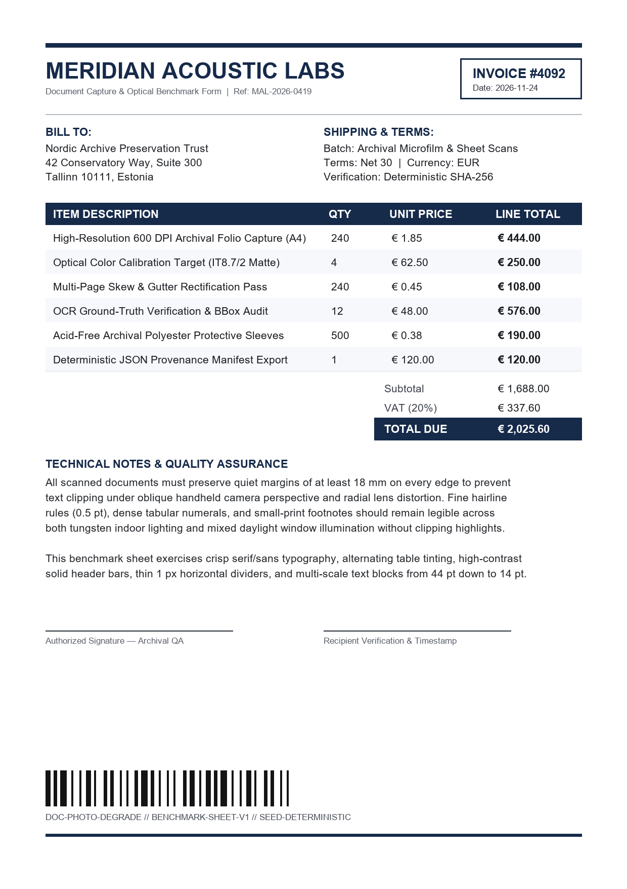
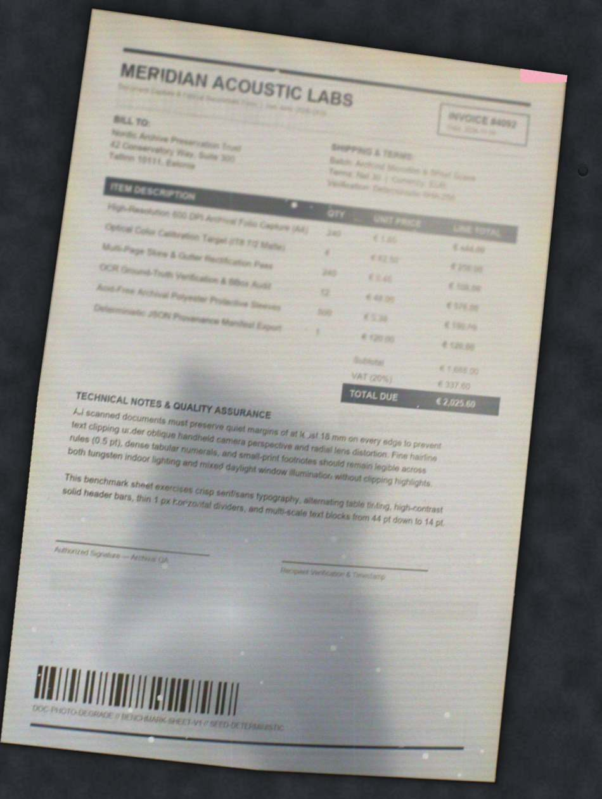
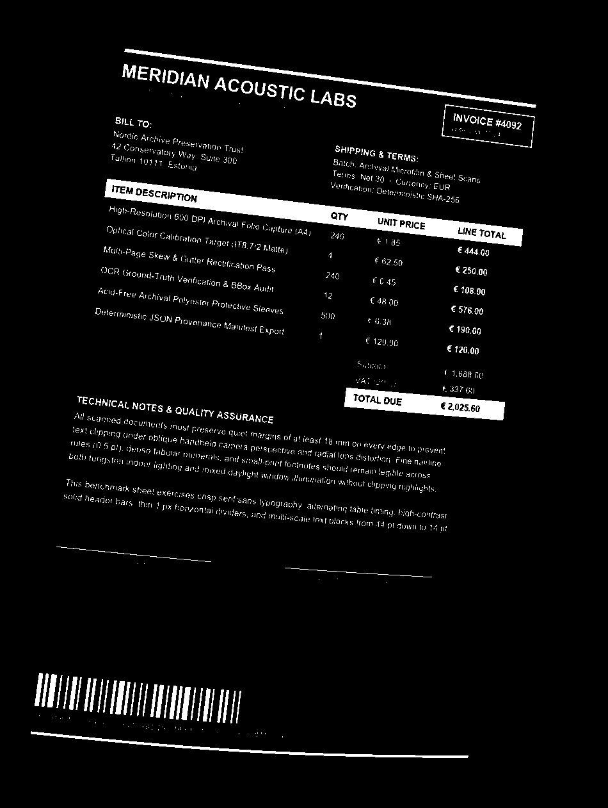
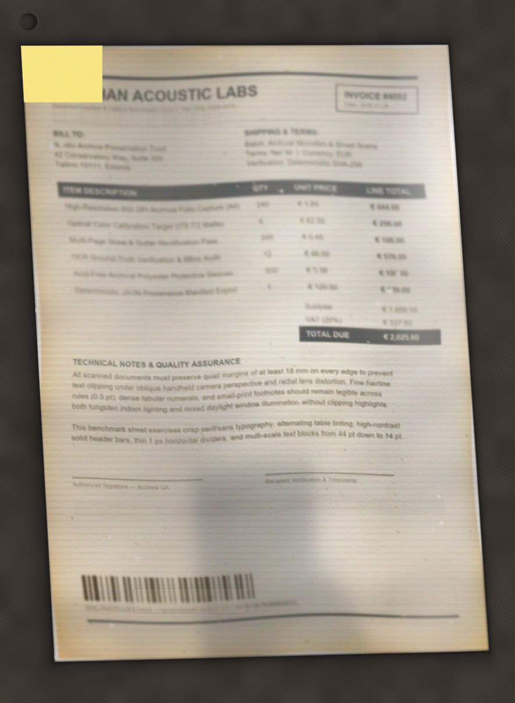
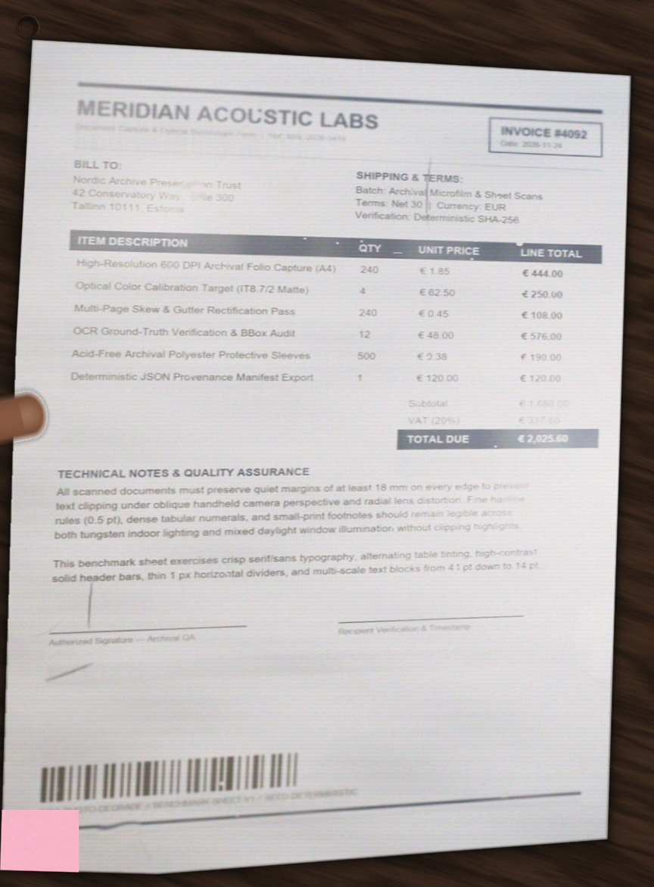
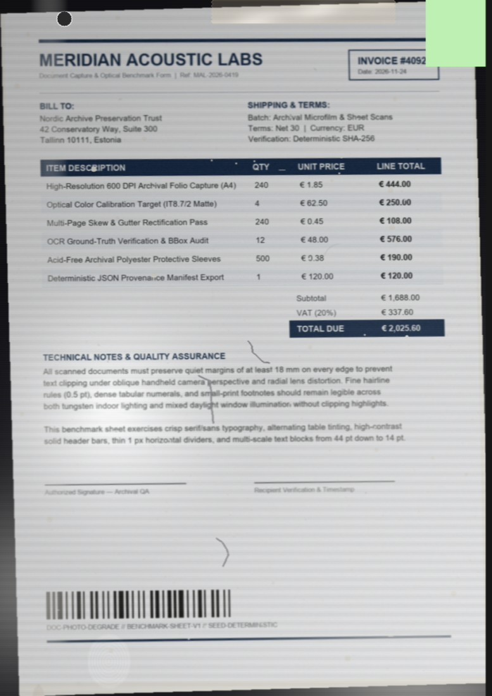
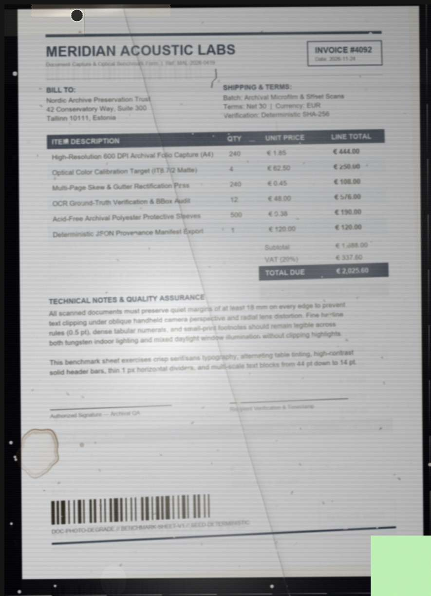
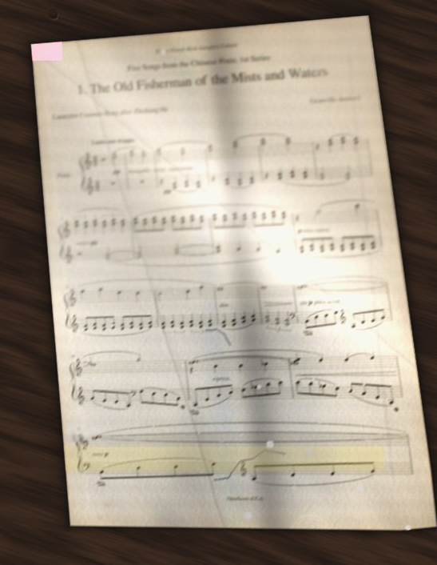
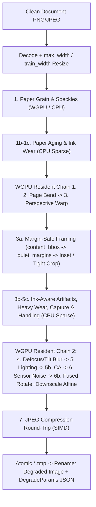

# `doc-photo-degrade`

[](LICENSE-MIT)
[](https://www.rust-lang.org/)
[](ARCHITECTURE.md)

> **Stop starving your GPUs with Python document augmenters.**
> `doc-photo-degrade` is a deterministic, margin-safe Rust + WGPU physics engine that turns clean PDFs and renders into photorealistic phone captures — with exact JSON provenance and label reprojection — at **~0.43 s/page** (WGPU fused) and **~0.54 s/page** (parallel Rust CPU) on full 2480 px pages.

Modern OCR, layout analysis, and document-AI models don't fail on clean digital renders — they fail in the wild, on crumpled receipts photographed under harsh office glare, curled book spines, faded archival paper, and tilted phone snaps. Yet most synthetic data pipelines are bottlenecked by single-threaded Python loops that randomly clip text off the page, silently invalidate bounding-box ground truth, and leave training GPUs idling.

`doc-photo-degrade` solves all three problems at once:

- **Physical realism across 10+ ordered stages (v0.3.0)** — 5 physical paper-texture engines (256×256 seamless laid/wove/cold-press micro-weave, Y-sorted curved cellulose fibers & recycled pulp flecks, archival edge oxidation / ferric foxing / corner finger-oil / watermarks, `PaperStock` micro-surface BRDF with OBA & capillary ink spread, and fused 6-octave phasor 3D cockling + raking-light paper-tooth bump + plate-mark/gutter emboss), 3D bend-coupled Lambertian normals, independent per-corner detachment (`inset` + margin-safe `offset`) with exact 2-Quad SDF desk & contact drop-shadows, handheld phone+hand cast shadows, anisotropic specular bloom, off-axis cubic radial CA + Petzval field-curvature corner softness, filmic smartphone tone-mapping LUT, 1/4-res High-ISO chroma blotch noise, edge-aware HDR USM, optional shifted double-JPEG, capillary tide-ring stains, dihedral creases with ink-flake cracking, Xerox drum ghosting, thermal receipt fade/scratches, flatbed scanner lid bar + CCD lines, richer LUT desks (`walnut`, `oak`, `granite_laminate`, `slate`, `cloth`), margin-safe fingertip/binder-clip/music-stand occluders, serrated scotch tape, and desk-through punch holes.
- **Mathematically margin-safe geometry & independent corner detachment** — each of the 4 page corners can detach inward (`inset`, revealing desk) or outward (`offset`, binary-searched against exact projective content safety) so document content is never clipped out of frame.
- **Exact JSON provenance, non-linear label reprojection & GT masks** — every degraded image is paired with a structured `DegradeParams` JSON sidecar; `transform_point_exact`, `unproject_point_exact`, `transform_bbox_exact`, and `transform_polygon_exact` map coordinates through **all 5 geometric stages including non-linear page bend** (`< 0.2 px` rendered centroid accuracy, `< 1e-9 px` algebraic round-trip), and `--export-masks` emits pixel-aligned UV flow, illumination, clean-ink, and artifact bitmasks for multi-task training.
- **Deterministic & fast** — multi-threaded Rust + SIMD codecs (`zune-png`, `zune-jpeg`, `jpeg-encoder` with true `4:2:0` chroma subsampling, `fast_image_resize`) + two-segment resident WGPU compute chains, with automatic, panic-free CPU fallback.

---

## Visual Examples (All 7 Profiles)

All renders below were generated with `--strength 0.65 --format jpeg --max-width 1240 --seed 42` directly by the `doc-photo-degrade` CLI (resized for compact README display).

### Before / After & Multi-Task Ground-Truth Masks (`phone-photo`)

| Clean Source | `phone-photo` Degraded | GT Illumination Field (`_illum.png`) | GT Clean Ink Mask (`_ink.png`) |
| :---: | :---: | :---: | :---: |
|  |  |  |  |

### All 7 Built-in Document Profiles

| `archival-manuscript` | `thermal-receipt` | `office-scan` | `photocopy-xerox` |
| :---: | :---: | :---: | :---: |
|  |  |  |  |

| `book-gutter-bend` | Clean Sheet Music | `sheet-music` Degraded |
| :---: | :---: | :---: |
|  |  |  |

---

## 1-Command CLI Quickstart

Install or build in release mode (always use `--release`; pixel loops are 10–50× slower in debug builds):

```bash
cargo build --release -p doc-photo-degrade
```

Degrade a single page or a whole directory of PNG/JPEG renders with one command:

```bash
# Default realistic phone capture (auto-enables WGPU if available, else CPU)
doc-photo-degrade --input ./clean_pages --out-dir ./out --profile phone-photo --format jpeg --seed 42
```

### Built-in Document Profiles

Choose a domain-calibrated `--profile` to match your target capture distribution:

```bash
# Everyday smartphone capture on a desk (balanced curl, glare, perspective, JPEG)
doc-photo-degrade --input page.png --out-dir out --profile phone-photo

# Aged paper, foxing spots, yellowing, ink browning, and water tide-lines
doc-photo-degrade --input page.png --out-dir out --profile archival-manuscript

# Low-contrast thermal fade, paper curl, heavy wear, and pocket creases
doc-photo-degrade --input page.png --out-dir out --profile thermal-receipt

# Flatbed/feeder scan: minimal perspective, subtle skew, scanner banding & dust
doc-photo-degrade --input page.png --out-dir out --profile office-scan

# High-contrast toner banding, streaks, dropout speckles, and misregistration
doc-photo-degrade --input page.png --out-dir out --profile photocopy-xerox

# Strong central book-spine gutter squeeze and spine shading
doc-photo-degrade --input page.png --out-dir out --profile book-gutter-bend

# Engraving-preserving degradation tuned for dense sheet music & fine staff lines
doc-photo-degrade --input page.png --out-dir out --profile sheet-music
```

### High-Throughput Training Flags

```bash
# Fast training preset at 1024 px model resolution (rescales pixel stats by k = 1024 / src_width)
doc-photo-degrade \
  --input ./clean_pages \
  --out-dir ./train_aug \
  --profile phone-photo \
  --preset reduced \
  --train-width 1024 \
  --format jpeg \
  --seed 2026
```

Key CLI flags:

| Flag | Default | Purpose |
|---|---|---|
| `--input <PATH>` | *(required)* | Input PNG/JPEG file or directory (non-recursive) |
| `--out-dir <DIR>` | `out` | Output directory for `<stem><suffix>.png\|jpg` + `<stem><suffix>_params.json` |
| `--profile <NAME>` | `phone-photo` | Domain preset (`phone-photo`, `archival-manuscript`, `thermal-receipt`, `office-scan`, `photocopy-xerox`, `book-gutter-bend`, `sheet-music`) |
| `--seed <U64>` | `0` | Master seed (directory file `i` derives `seed + i * 0x9E3779B97F4A7C15`) |
| `--strength <F32>` | `0.5` | Global degradation intensity in `[0.0, 1.0]` |
| `--max-width <U32>` | `2480` | Cap input width before degradation (`0` = keep native) |
| `--train-width <U32>` | `0` | Downscale to training width before degradation and rescale pixel statistics (`0` = full-res) |
| `--scale-min <F32>` | `0.5` | Minimum random output capture downscale factor in `(0.0, 1.0]` (`1.0` = keep size) |
| `--format <FMT>` | `png` | Output image format: `png` (lossless) or `jpeg` |
| `--preset <NAME>` / `--reduced` | `full` | Pipeline fidelity preset (`full` vs `reduced`: skips fine grain, CA, sensor noise; coarsens ink & aging) |
| `--skip-bend` | `false` | Skip non-linear page bend (enables exact projective/affine bounding-box reprojection) |
| `--fast-banks` | `false` | Precomputed 256×256 tiled Gaussian banks + precomputed lighting field on CPU |
| `--export-masks` | `false` | Export pixel-aligned ground-truth masks (`uv_flow`, `illumination`, `clean_ink`, `artifacts`) |
| `--mask-format <FMT>` | `npy-png` | Floating-point mask format: `npy-png` (NumPy `.npy` v1.0 + PNG) or `png16` (16-bit RGB PNG) |
| `--no-corner-detach` | `false` | Disable independent per-corner detachment (fall back to legacy `inset`/`tight` framing) |
| `--corner-inset-prob <F32>` | `0.6` | Per-corner probability in `[0.0, 1.0]` of detaching inward (`inset`) vs outward (`offset`) |
| `--gpu` / `--cpu` | auto | Require WGPU (fail if unavailable) or force CPU; default auto-detects GPU with clean CPU fallback |

---

## 10-Line Rust Library Quickstart

Add `doc-photo-degrade` to your `Cargo.toml`:

```toml
[dependencies]
doc-photo-degrade = "0.3"
image = "0.25"
```

```rust
use doc_photo_degrade::{DegradeParams, Degrader, DocumentProfile};

fn main() -> Result<(), Box<dyn std::error::Error>> {
    let clean = image::open("page.png")?.to_rgb8();
    let degrader = Degrader::builder()
        .profile(DocumentProfile::PhonePhoto)
        .strength(0.65)
        .build()?;
    let result = degrader.degrade_image(&clean, 42)?;
    let _sidecar: &DegradeParams = &result.params;
    result.image.save("page_degraded.png")?;
    Ok(())
}
```

For GPU-less or minimal-dependency builds, disable the default `gpu` feature:

```toml
doc-photo-degrade = { version = "0.3", default-features = false }
```

---

## Stage Pipeline Architecture

Dense per-pixel stages run in two **resident single-submit WGPU compute chains** (or multi-threaded CPU loops), split around margin-safe framing and ink-aware sparse physical defects:



Why the two-segment split? Framing must measure the post-perspective dark-pixel bounding box (`content_bbox`) against clean paper fill *before* rotation introduces dark desk triangles. Deferring rotation into the terminal `run_affine` pass of Chain 2 fuses rotation and capture downscaling into a single 4-tap bilinear dispatch and eliminates an entire host↔GPU round-trip per page. See [ARCHITECTURE.md](ARCHITECTURE.md) for the full math and shader layout.

---

## Honest Comparison

| Capability | `doc-photo-degrade` | Augraphy | Albumentations | DocCreator |
|---|---|---|---|---|
| **Language & Runtime** | Native Rust + optional WGPU | Python (OpenCV / NumPy) | Python (OpenCV / NumPy) | C++ / Qt GUI & CLI |
| **GPU Acceleration** | Built-in WGPU compute chains (Vulkan / DX12 / Metal) | CPU only | CPU only (OpenCV) | CPU / OpenGL |
| **Margin-Safe Framing** | **Guaranteed** (`content_bbox` + quiet-margin clamp + corner bleed cap) | Manual / heuristic | Not document-aware | Partial |
| **JSON Provenance & Bbox Reprojection** | **Built-in** (`DegradeParams` sidecar on every image) | Optional / partial | Bbox support for generic geometric ops | Limited |
| **Determinism** | **Bit-exact per backend** (ChaCha8 CPU / hash-stream GPU) | Seeded NumPy/Python | Seeded NumPy/Python | Seeded |
| **Document Physics** | 10-stage camera + paper + ink + book-spine pipeline | Very broad paper/printer library | General CV (not document-specific) | Historical manuscript focus |
| **Best Fit** | High-throughput OCR/OMR/DocAI training pipelines needing speed + intact labels | Rapid Python prototyping with exotic paper filters | General natural-image vision augmentation | Interactive historical document synthesis |

---

## Determinism & Backend Contract

`doc-photo-degrade` is built for reproducible dataset generation:

- **Per-file independent seeds:** Every image in a batch derives its own seed (`seed.wrapping_add(i * 0x9E37_79B9_7F4A_7C15)`). Multi-threaded directory runs produce **bit-identical** outputs regardless of thread scheduling or completion order.
- **Per-backend determinism:**
  - **CPU backend (`--cpu`):** Every random draw comes from a seeded `ChaCha8Rng` (and independent SplitMix64-avalanched `ChaCha8Rng` streams for `--fast-banks`). Same seed + same config ⇒ bit-identical bytes across runs.
  - **WGPU backend (`--gpu` / auto):** Dense paper-grain and sensor-noise kernels use deterministic per-pixel WGSL hash streams with distinct stream IDs (`grain_seed32` vs `noise_seed32`, XOR-folded from the 64-bit file seed). Outputs are **bit-identical across GPU runs**, but intentionally differ at the pixel level from CPU runs at the same seed.
- **Fallible GPU initialization:** `GpuContext::try_new()` / `Gpu::new()` never panics on headless or GPU-less machines. Default auto mode falls back cleanly to CPU; passing `--gpu` returns a structured error if no usable adapter exists.
- **Explicit provenance:** Every `<stem>_params.json` sidecar records `"backend": "gpu" | "cpu"`, `"preset": "full" | "reduced" | "custom"`, `"rot_scale_fused": true | false`, and every geometric and photometric parameter.
- **Crash-safe writes:** All output images and JSON sidecars are written to a sibling `*.tmp` file and atomically renamed into place so an interrupted batch never leaves a half-written artifact.

---

## Measured Throughput

Benchmarked in `--release` mode on **10 full-resolution 2480 px document pages** (Windows 11, Ryzen 7 7800X3D, RTX 4080 SUPER 16 GB):

| Mode | Wall Time (10 × 2480 px pages) | Throughput | Notes |
|---|---:|---:|---|
| **WGPU fused (`--gpu`, release)** | **~4.3 s** *(4.3–5.0 s across runs)* | **~0.43 s/page** | Resident two-segment compute chains + fused rotate/downscale affine (~1.25× faster than CPU, ~1.37× faster than pre-fusion GPU) |
| **Parallel CPU (`--cpu`, release)** | **~5.4–5.5 s** | **~0.54 s/page** | All cores via `std::thread::scope` + SIMD codecs (`zune` / `fast_image_resize`) |
| **Pre-fusion GPU (reference)** | ~5.9 s | ~0.59 s/page | Per-stage GPU round-trips before chain fusion |

Need even higher throughput for online or large-scale training epochs? Combine **`--preset reduced`** (skips fine paper grain, chromatic aberration, and sensor noise; coarsens ink and paper aging while preserving topology-changing defects) with **`--train-width 1024`** (downscales before degradation and rescales absolute-pixel statistics by `k = train_width / src_width`).

---

## Runnable Examples

Explore the library API directly with Cargo:

| Example | What it demonstrates | Command |
|---|---|---|
| [`examples/01_quick_degrade.rs`](crates/doc-photo-degrade/examples/01_quick_degrade.rs) | Minimal single-image degradation + JSON sidecar export | `cargo run --release -p doc-photo-degrade --example 01_quick_degrade` |
| [`examples/02_strength_sweep.rs`](crates/doc-photo-degrade/examples/02_strength_sweep.rs) | Sweeping global strength values from clean to heavily degraded | `cargo run --release -p doc-photo-degrade --example 02_strength_sweep` |
| [`examples/03_bench_throughput.rs`](crates/doc-photo-degrade/examples/03_bench_throughput.rs) | Measuring single-image and batch throughput across presets | `cargo run --release -p doc-photo-degrade --example 03_bench_throughput` |
| [`examples/04_reproject_bboxes.rs`](crates/doc-photo-degrade/examples/04_reproject_bboxes.rs) | Reprojecting ground-truth OCR bounding boxes & polygons using `DegradeParams` | `cargo run --release -p doc-photo-degrade --example 04_reproject_bboxes` |

---

## Documentation & Links

- **Architecture & Math:** [ARCHITECTURE.md](ARCHITECTURE.md)
- **Contributing & Dev Setup:** [CONTRIBUTING.md](CONTRIBUTING.md)
- **Changelog:** [CHANGELOG.md](CHANGELOG.md)
- **Repository:** <https://github.com/gregoreesmaa/doc-photo-degrade>

## License & Citation

Dual-licensed under either of:

- **MIT License** ([LICENSE-MIT](LICENSE-MIT))
- **Apache License, Version 2.0** ([LICENSE-APACHE](LICENSE-APACHE))

at your option. All dependencies are permissive (MIT/BSD/Apache); no GPL/AGPL tools or external system binaries are required.

If you use `doc-photo-degrade` in research or Document AI benchmarks, please cite:

```bibtex
@software{eesmaa_doc_photo_degrade_2026,
  title        = {doc-photo-degrade: Deterministic, Margin-Safe Rust + WGPU Document Photo Degradation Engine},
  author       = {Gregor Eesmaa and doc-photo-degrade contributors},
  year         = {2026},
  version      = {0.3.0},
  license      = {MIT OR Apache-2.0},
  url          = {https://github.com/gregoreesmaa/doc-photo-degrade}
}
```
